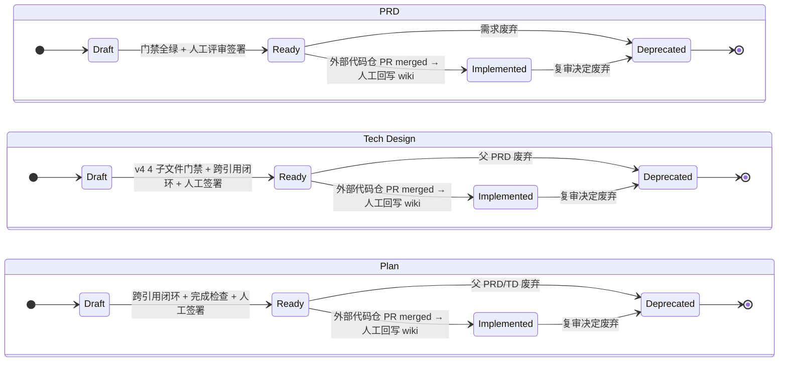
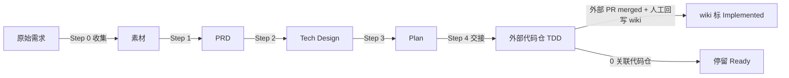
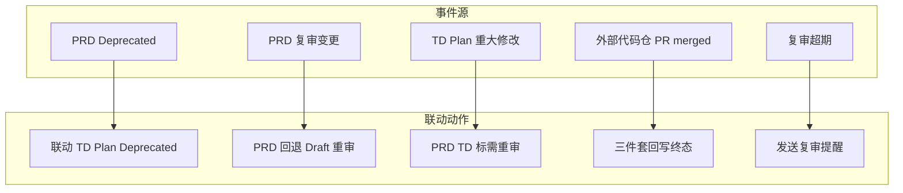

# SSD-Template 使用指南

> **契约唯一真源** = 仓根 [WORKFLOW.md](WORKFLOW.md)(编排配置 + agent 工作契约)。
> 本指南讲**怎么用**;`WORKFLOW.md` 讲**agent 必须怎么做**。两者冲突时以 `WORKFLOW.md` 为准。
> 参考资料可信度排序:`WORKFLOW.md` > `schema/**` 模板 > [AGENTS.md](AGENTS.md) > 本文件 > [README.md](README.md)。

## 核心理念

### Why-First

在写任何代码前,回答四个问题:

1. **为什么有这个流程?** 它解决什么问题?
2. **具体解决什么问题?** 问题是什么?
3. **代码为什么这样设计?** 决策依据是什么?
4. **这应该放在哪里?** 哪个组件负责?

### Given/When/Then

用自然语言描述行为:

- **Given** 前置条件
- **When** 触发动作
- **Then** 预期结果

### 复审机制

每个 PRD 定期复审,防止 feature rot:

- **仍然重要?** Yes / No / 重新定义
- **应当保留?** Yes / No
- **可以删除?** Yes / No

### Harness 原则

工作流是固定的 harness,不是灵活的建议:

- 5 步必须走完,不简化
- 每步有明确的"门禁清单"
- 违反则失败,不跳过

## 如何使用本指南

### 谁来读

本指南面向 AI agent 和开发者,用于规范从需求到代码的完整流程。

### 从哪里开始

当有新的需求时:

1. **Step 0: 收集原始需求** 将原始描述或文件引用放入 `prd/{YYYY-MM-DD}/`(多文件),或启用 `material/{YYYY-MM-DD}/` 可选层
2. **Step 1: 加工为 PRD** 读 `prd/{YYYY-MM-DD}/`,产出 PRD 到 `prd/{YYYY-MM-DD}/{topic}.md`
3. **Step 2: PRD → Tech Design** 产出多文件 Tech Design 到 `tech_design/{YYYY-MM-DD}-{topic}/`(v4 默认 4 子文件)
4. **Step 3: Tech Design → Plan** 产出 Plan 到 `plan/{YYYY-MM-DD}-{topic}/{topic}.md`
5. **Step 4: 执行 TDD** 按 Plan 的验证用例进入 Red → Green → Refactor(仅 ≥1 关联代码仓时)

> 可选 Layer 4:`test_cases/{YYYY-MM-DD}/{topic}.md`(项目启用时存在,配合 [schema/test_case.md](schema/test_case.md) 模板产出)
> 可选素材区:`material/{YYYY-MM-DD}/`(见 [material/README.md](material/README.md))
> **状态起点**:agent 产出的三层规格状态是 `Draft`;`Ready` 由人工评审签署后写入(见下方状态流转)。

### 遇到问题时

- **不确定填什么?** 查看对应 schema 模板 [schema/prd.md](schema/prd.md)
- **不知道覆盖哪些场景?** 参考下方门禁清单
- **不确定一个需求走多深?** 默认走完 5 步,不简化
- **多仓项目怎么写 Plan?** 见 [AGENTS.md](AGENTS.md) §1.5 多仓 Plan 编排
- **怎么声明设计基于的代码现状?** 见 [AGENTS.md](AGENTS.md) §1.6 实现基线
- **怎么引用代码现状作为证据?** 见 [AGENTS.md](AGENTS.md) §1.7 证据锚点
- **agent 到底能写什么、不能写什么?** 见 [AGENTS.md](AGENTS.md) §3.3 状态流转 与 `WORKFLOW.md` §3 硬禁止

### 状态流转

3 层各自维护独立的状态机(详见 [状态机详解](#状态机详解-state-machine)):



> **agent 的权限天花板 = `Draft`**。`Ready` / `Implemented` / `Deprecated` 三个状态由**人**决定。
> **0 关联代码仓库**:规格停留在 Ready,标记 "Awaiting TDD in external code repo"(本仓库为纯 wiki)
> **≥1 关联外部代码仓库**:外部代码仓(位于本仓库**之外**)PR merged 后,人工回写 wiki 状态进入 Implemented
> **Deprecated**:3 层均支持,上游废弃时下游级联

## 目录组织(核心 4 个文件夹 + 可选层)

```text
{project-root}/
├── prd/              # 素材区 + Layer 1: PRD(素材区非独立 Layer)
├── tech_design/      # Layer 2: 技术设计(按功能组织,v4 默认 4 子文件)
├── plan/             # Layer 3: 实施计划(按功能组织)
├── schema/           # 模板定义
├── material/         # 可选: Layer 0 素材区 + 批次 PRD 台账
├── test_cases/       # 可选: Layer 4 黑盒用例
└── deep/             # 可选: 深度理解层
```

**prd/ 命名** (素材区 + Layer 1,见 [prd/README.md](prd/README.md)):

```text
prd/
└── {YYYY-MM-DD}/              ← 日期分桶(素材 + PRD 同目录)
    ├── {source-1}.md          ← 素材(只读,非 Layer 制品)
    └── {topic}.md             ← Layer 1: PRD
```

**plan/ 命名** (单文件):

```text
plan/
└── {YYYY-MM-DD}-{topic}/
    └── {topic}.md             ← 内容文件,文件名 = 目录名里的 topic
```

**tech_design/ 命名** (v4 默认,见 [tech_design/README.md](tech_design/README.md)):

```text
tech_design/
└── {YYYY-MM-DD}-{topic}/
    # v4 (默认, 4 子文件 - 存 ards.md 或 apis.md 则走 v4 校验)
    ├── README.md              ← 综合描述 + 场景映射 + 实现基线(必填)
    ├── ards.md                ← 架构决策 + 方案对比 + 探索机制 + Gap(必填)
    ├── apis.md                ← 接口契约 + 枚举速查 + 时序图(必填)
    └── data-model.md          ← ER 图 + 数据结构明细(必填)

    # v3 (存量 / 显式 opt-in, 6 子文件 + 条件 interactions)
    # ├── README.md            ← 入口/索引(必填)
    # ├── decisions.md         ← 关键决策(必填)
    # ├── data-model.md        ← 数据模型(必填)
    # ├── api-contracts.md     ← API 契约(必填)
    # ├── scenario-mapping.md  ← 场景映射(必填)
    # ├── interactions.md      ← 时序图(视情况)
    # └── quality.md           ← 指标 + 降级 + 错误(必填)
```

## 5 步工作流



### Step 0: 收集原始需求

原始素材(用户抱怨、会议纪要、需求文档)放入 `prd/{YYYY-MM-DD}/`(多文件,**只读**)。
项目需要独立的素材暂存区 + 批次 PRD 台账时,启用 [material/README.md](material/README.md) 描述的可选素材区。

> `prd/{YYYY-MM-DD}/` 是 Layer 1 的**素材区**,**不是**独立 Layer。架构层只有 3 层(Layer 1/2/3),详见 [prd/README.md](prd/README.md)。

### Step 1: 原始素材 → Layer 1 PRD

经过分析和讨论收敛,产出 PRD 到 `prd/{YYYY-MM-DD}/{topic}.md`,状态 `Draft`,评审签署后转 `Ready`。

**转换关系**:
- **1:1**: 一份原始文档对应一个 PRD
- **1:N**: 一份原始文档(如 `history-apis.md`)拆成多个 PRD
- **N:1**: 多份原始文档合成一个 PRD
- **N:N**: 更复杂的 1→N→M 组合

**PRD 必填**(机器必填 5 段,权威定义见 [schema/prd.md](schema/prd.md)):

- **为什么 (Why)**: 一句话说明问题和目的
- **目标 (Goal)**: 可验证的成功标准(须含可勾选项 `- [ ]`)
- **场景 (Scenarios)**: Given/When/Then,覆盖正常路径 + 至少一个异常(`**But**`)
- **不在范围内 (Out of Scope)**: 明确不做的内容
- **复审 (Review)**: 评审签署三行 + still_matters / should_keep / can_delete 三问(防止 feature rot)

> `## 链接 (Links)` 与 `## 变更记录 (Change Log)` 是**推荐段**,不参与机器校验;用得到就写,不用可省。

### Step 2: PRD → Layer 2 Tech Design

基于状态为 `Ready` 的 PRD,产出 `tech_design/{YYYY-MM-DD}-{topic}/`(**v4 默认** 4 子文件):

- **README.md** — 综合描述 + `## 场景映射` + `## 实现基线`
- **ards.md** — 架构决策 / 方案对比 / 探索机制 / Gap
- **apis.md** — 接口契约 / 枚举速查 / 时序图
- **data-model.md** — ER 图 / 数据结构明细

> **代际选择**:v4 是**默认代际**,新建目录一律按 v4 产出。v3(6 子文件 + 条件 interactions)是**存量 / 显式 opt-in**,校验脚本保留 v3 分支但**不迁移**存量目录。
> v4 模板见 [schema/tech_design/ards.md](schema/tech_design/ards.md) + [schema/tech_design/apis.md](schema/tech_design/apis.md)。

**Tech Design 必填**:

- **关键决策 (KD)**: 方向选择 / 方案对比 / OQ / Spikes / Pivot / Enforced by
- **场景映射**: PRD 场景 → 组件/动作/数据模型(PRD 的每个场景都要被映射)
- **实现基线**: 设计所基于的代码现状快照(见 [AGENTS.md](AGENTS.md) §1.6)
- **指标**: 具体数字(不是模糊描述)
- **降级策略**: 异常情况下的行为

### Step 3: Tech Design → Layer 3 Plan

基于状态为 `Ready` 的 Tech Design,产出 `plan/{YYYY-MM-DD}-{topic}/{topic}.md`(**Ready**):
变更索引 + 变更清单 + TDD 流程 + 跨文件引用对账 + 验证用例 + 业务约束 + 开发约束 + 完成检查。

**Plan 必填**:

- **变更索引**: 表格快速扫读(# / 文件路径 / 类型 / KD 引用 / V 引用 / 状态)
- **变更清单**: 每个文件的"变更描述"(新增/修改/删除什么) + "策略约束"(怎么做、不做什么)
- **跨文件引用对账**: KD / SYS / MOD / FR / V 闭环检查
- **验证用例 (V)**: Given/When/Then,TDD 阶段执行
- **业务约束**: 前置/不变量/后置/副作用
- **开发约束**: 并发/事务/幂等性/重试/超时
- **完成检查**: 4 段(实现层 / 验证层 / 引用层 / 流程层)

> ⚠️ **设计原则**:Plan 是"实施指南",不是"替代实现"。
> 变更描述用文字说明策略和约束,指导参与的 agent 写出代码。
> 完整代码在 TDD 阶段产出,不是提前写在 Plan 里。

> **多仓项目**:变更清单按仓分组,组标题为 `#### {仓库标识} 变更`,Change 路径带 `{标识}/` 前缀,V 用例按场景聚合。完整规则见 [AGENTS.md](AGENTS.md) §1.5。

### Step 4: 执行 (Plan → TDD → 外部代码仓)

按 Plan 进入 TDD 循环:

1. **Red** 写一个失败的测试(V 用例)
2. **Green** 写最少代码让测试通过
3. **Refactor** 优化代码,保持测试通过

完成所有 V 用例后,wiki 状态按**外部关联代码仓情况**分两条路:

- **≥1 关联外部代码仓**(代码仓位于本仓库**之外**,独立 Git 仓库 / monorepo 子目录):
  - 外部 TDD 全过 + 外部 PR merged 后
  - 由人类**人工回写**本 wiki 三件套状态:PRD → **Implemented**,Tech Design → **Implemented**,Plan → **Implemented**
- **0 关联代码仓**(纯文档项目,如 SSD-Template 自身):停留在 **Ready**,标记 "Awaiting TDD in external code repo"

详见 [状态机详解](#状态机详解-state-machine)。

> 💡 **AI Coding Agent 场景的简化路径**:
>
> 当 fork 项目的代码仓由 AI coding agent(Claude Code / aider / Cursor / Codex 等)接管时:
> - **wiki 文件本地可达** → coding agent 直接 `cat plan/.../topic.md` 即可消费,**零同步成本**
> - **Plan Ready = 工作信号** → 不需要 wiki agent 派活 / issue kickoff
> - **coding agent 自带 spec→code 工作流** → "读 plan → 写代码 → 跑测试"是其原生能力
> - **人工回写 wiki 状态** 是**唯一**的人工介入点(外部 PR merged 后)
>
> **不要**为 coding agent fork 引入 wiki agent kickoff / `Implementing` 中间态 / 调度机制。
> 这是把 "Plan = 可执行规约"(executable specification)的简单模型,人为退化为 "Plan = 待派工单"的复杂模型。
> 反例论证见下文 [为什么不引入 `Implementing` 中间态](#为什么不引入-implementing-中间态)。

## 状态机详解 (State Machine)

> 每层独立维护自己的状态(per-layer independent lifecycle)。上方"状态流转"段的 3 个 stateDiagram-v2 已包含完整图,本节补充状态值枚举、转换触发、跨层协调规则。

### 状态值枚举

**全层统一 4 值**,不得自造状态名:

| 层 | Draft | Ready | 终态 | Deprecated |
|----|-------|----------------|------|------------|
| PRD | Draft | Ready | Implemented | Deprecated |
| Tech Design | Draft | Ready | Implemented | Deprecated |
| Plan | Draft | Ready | Implemented | Deprecated |

> **术语分层**:
> - **三件套 = Implemented** 3 层状态机统一终态;Plan 侧重"已被消费/执行完毕",PRD / Tech Design 侧重"对应代码已落地到生产(已实施)"
> - **Deprecated** 3 层统一支持;上游废弃时下游级联

### 转换触发条件

> **脚本只强制「格式与追溯」,不强制「状态判定」。**
> `scripts/check-md-schema.sh` 校验的是必填段、状态枚举取值、占位符清零与**阶段感知**(`Ready` 阶段复审段三行必须是真值);
> `scripts/check-traceability.sh` 校验的是跨层引用闭环与 `Deprecated` 级联一致性。
> **脚本无法判定评审的实质**:`Draft → Ready` 取决于人是否真的评审过,`Ready → Implemented` 取决于外部 PR 是否真的 merged,
> `* → Deprecated` 取决于是否真的废弃。这三件事一律由**人**决定,门禁只提供"可评审"的保证。

| 当前 → 下一 | 触发条件 | 校验命令 | 责任方 |
|------------|---------|----------|--------|
| — → Draft (PRD / TD / Plan) | 产物写完 + 该层门禁全绿 | `scripts/check-naming.sh` + `scripts/check-md-schema.sh` + `scripts/check-traceability.sh` | **agent** |
| Draft → Ready (PRD) | `check-md-schema.sh <prd>` 返回 0 **且** 人工在 `## 复审 (Review)` 段填入 `> **评审人**` / `> **评审日期**` / `> **评审结论**` 三行 | `scripts/check-md-schema.sh prd/{YYYY-MM-DD}/{topic}.md` | 人工 reviewer |
| Draft → Ready (TD) | `check-md-schema.sh <td_dir>` 返回 0 **且** 所有子文件状态就绪 **且** 人工签署复审段 | `scripts/check-md-schema.sh tech_design/{YYYY-MM-DD}-{topic}/` | 人工 reviewer |
| Draft → Ready (Plan) | `check-md-schema.sh <plan>` 与 `check-traceability.sh` 均返回 0 **且** 人工签署复审段 | `scripts/check-md-schema.sh plan/{YYYY-MM-DD}-{topic}/{topic}.md` + `scripts/check-traceability.sh` | 人工 reviewer |
| Ready → Implemented (PRD/TD/Plan) | **≥1 外部代码仓**:外部 TDD 全过 + 外部 PR merged + 人工回写 wiki 三件套状态 | 人工检查外部仓库(无脚本) | 外部 reviewer + wiki 人工回写 |
| Ready (停留) | **0 关联代码仓**:无外部回写源 | N/A | (无动作) |
| * → Deprecated | 需求废弃 / 复审决定废弃 | 人工决策(级联一致性由 `scripts/check-traceability.sh` 兜底) | 人工 reviewer |

**评审签署载体**(Ready 的机器可核验依据):

```markdown
## 复审 (Review)

> **评审人**: {github-handle}
> **评审日期**: YYYY-MM-DD
> **评审结论**: 通过 / 不通过(附理由)
```

> 三行必须填**真值**,不能留占位符。`Draft` 阶段三行**留空**(段本身存在),由人签署。
> 提交信息里的 `Reviewed-by:` trailer 是评审动作的**记录**,取值只能来自人工填写的 `> **评审人**`;它**不是**门禁依据。

**三件套一致性规则**(Ready → Implemented 转换):
- PRD / Tech Design / Plan 三个状态**必须同时**进入 Implemented(不允许单层先 Implemented)
- 状态转换由**人类手动**回写 wiki,**不**自动触发(避免外部 PR merged 与 wiki 状态不一致)

> **scripts 使用方法**:统一用 `bash scripts/<name>.sh` 调用(不要用 `./`;脚本从自身位置推导仓根,任何 cwd 都可以)。
> 根目录跑 `bash scripts/check-naming.sh` + `bash scripts/check-md-schema.sh` + `bash scripts/check-traceability.sh`,三个脚本全返回 0 即"可评审"。
> 项目有关联代码仓时,额外跑 `bash scripts/check-repo-baseline.sh` 核对 Tech Design 的实现基线(见 [AGENTS.md](AGENTS.md) §1.6)。

### 跨层协调规则



### 0 关联代码仓库的特殊语义

> ⚠️ **核心原则**:本仓库**永远是 wiki**(spec 仓库),**永远不会**变成代码仓。
> 即使项目有关联的代码仓,代码仓也**位于本仓库之外**(独立 Git 仓库 / monorepo 子目录 / 其他物理位置)。
> 本仓库**不包含** `src/`、`cmd/`、`pkg/`、`internal/` 等代码目录。这些只存在于**外部**代码仓。

#### 术语澄清

| 表述 | 准确语义 |
|------|---------|
| **本仓库 / 本 wiki** | 始终是规格文档仓库,**永远不会**变成代码仓 |
| **0 关联代码仓库** | 本 wiki 未关联任何外部代码仓库(纯文档项目) |
| **≥1 关联代码仓库** | 本 wiki 关联了 N 个**外部**代码仓库(代码仓位于本仓库**之外**) |
| **外部代码仓** | 独立 Git 仓库 / monorepo 子目录,通过 `{仓库标识}/{path}` 跨仓引用(详见 [AGENTS.md](AGENTS.md) §1.2) |
| **wiki 的 Implemented** | 外部代码仓 PR merged 后,**人工回写**到本 wiki 的镜像状态 |

#### 本模板自身(0 关联代码仓库)

- Step 1 产出:`prd/{YYYY-MM-DD}/{topic}.md` 状态 **Draft**(评审后 Ready)
- Step 2 产出:`tech_design/{YYYY-MM-DD}-{topic}/*` 状态 **Draft**(评审后 Ready,v4 默认 4 子文件)
- Step 3 产出:`plan/{YYYY-MM-DD}-{topic}/{topic}.md` 状态 **Draft**(评审后 Ready)
- 不进入 Implemented(无外部代码仓作为回写源)
- Tech Design 的 `## 实现基线` 段写「不适用: 本项目无关联代码仓」(见 [AGENTS.md](AGENTS.md) §1.6)

#### Fork 后接入外部关联代码仓库

> 外部代码仓**独立**于本仓库,本仓库保持纯 wiki 状态:

- 按 [AGENTS.md](AGENTS.md) §4.A 定制指南 在 §1.1 登记外部代码仓清单(仓库地址 / 主要语言 / 角色)
- 跨仓引用统一使用 `{仓库标识}/{path}` 写法
- Step 4 (TDD) 在**外部代码仓**内执行,**不**在本仓库
- 外部 PR merged 后,由人类**人工回写**本 wiki 三件套状态为 Implemented
- 维护"外部代码仓 → 本 wiki"的状态同步规则

### 为什么不引入 `Implementing` 中间态?

> **反例论证** 帮助 fork 项目避免错误地复杂化

如果 fork 项目考虑在 `Ready → Implemented` 之间加一个 `Implementing` 状态(表示"正在 code repo 实施中"),请先回答:

| 设想加 `Implementing` 的理由 | 实际是否需要? |
|---------------------------|---------------|
| "想看到哪些 Plan 正在被实施" | ❌ git branch / PR 状态已记录此信息,去 wiki 看是冗余 |
| "防止多个 agent 重复领取" | ❌ git branch naming 约定(`plan/{date}-{topic}`)即可去重 |
| "想统计 in-flight 工作量" | ❌ code repo 的 PR list 就是权威数据源 |
| "想在 Implementing 状态校验进度" | ❌ TDD 是细粒度过程,不适合粗粒度状态机 |

**结论**:`Implementing` 中间态为流程增加了 **+1 张状态图 + 1 套转换规则 + 1 个跨仓写权限**,但解决的全是 code repo 自己能解决的问题。

**唯一例外**:仅当 ≥2 个 code agent 同时从同一 wiki 拉活**且无 git 协调能力**时(罕见),才需要 `Implementing` 中间态 + 显式调度。参见 [AGENTS.md](AGENTS.md) §4.A 的 fork 启动模式选项。

## 何时升级

> 简化原则: 默认所有内容用 3 个 schema。只在以下情况考虑升级。

| 触发条件 | 升级方案 | 状态 |
|---------|---------|------|
| 决策影响 ≥3 个 PRD 或长期架构 | 独立 ARD | v2 引入 |
| 多需求聚合管理 | batch-overview | v2 引入 |
| 需要可执行 BDD 框架 | 已在 PRD/Plan 内联 Given/When/Then,无需独立 | N/A |

## 门禁清单(权威定义见 `schema/*`)

> **门禁清单的权威定义在各 `schema/*` 文件内**。本节不复制,避免与 schema 漂移。
> 下表是**速查索引**,实际勾选项以 schema 文件为准。

| 层 | 门禁清单位置 | 自动校验 |
|----|-------------|---------|
| PRD | [schema/prd.md](schema/prd.md) 全文 + `scripts/check-md-schema.sh` | ✓ |
| Tech Design | [schema/tech_design/README.md](schema/tech_design/README.md) + 各子文件"门禁清单"段 + `scripts/check-md-schema.sh` | ✓ |
| Plan | [schema/plan.md](schema/plan.md) 完成检查段 + `scripts/check-md-schema.sh` + `scripts/check-traceability.sh` | ✓ |
| 实现基线(可选) | Tech Design `## 实现基线` 段 + `scripts/check-repo-baseline.sh` | ✓(有关联代码仓时) |

**脚本总表**(退出码:`0` = 通过,`1` = 存在违规,`2` = 调用 / 环境错误):

| 脚本 | 什么时候跑 | 查什么 |
|------|------------|--------|
| `scripts/check-naming.sh` | **每次都跑** | 目录 / 文件命名与层结构形状 |
| `scripts/check-md-schema.sh` | **每次都跑** | 必填段、状态枚举、阶段感知(草稿 / 评审 / 终态) |
| `scripts/check-traceability.sh` | **每次都跑** | 跨层引用闭环(KD / V / FR / SYS / MOD) |
| `scripts/check-doc-links.py` | **每次都跑** | 仓内受版本控制的 Markdown 相对链接死链 |
| `scripts/check-line-endings.sh` | **每次都跑** | 受版本控制的文本文件不得含 CR(行尾统一 LF) |
| `scripts/check-repo-baseline.sh` | 有关联代码仓时 | Tech Design `## 实现基线` 的 6 列快照 |
| `scripts/sync-prd.sh --check` | 启用了 PRD 台账时 | README 统计块与实际制品一致 |
| `scripts/sync-test-index.sh --check` | 仅 Layer 4 | `test_cases/_index.md` 与用例元信息一致 |

**调用方式**:三件套 Ready 前跑上表前 5 个脚本,全返回 0 方可提交评审;`Ready` 由人工签署复审段后写入。

## 可选层

全部**默认关闭**。目录或文件不存在时,对应校验自动跳过,模板自身零实例故全绿。

| 层 | 位置 | 用途 | 启用方式 | 说明 |
|----|------|------|----------|------|
| 素材区 | [material/](material/README.md) | 原始素材暂存 + 批次 PRD 台账 | 建 `material/` 目录 | Layer 0(可选) |
| PRD 台账 | `material/{YYYY-MM-DD}/PRDS.md` | 11 列台账,追踪素材到 PRD 的流转 | 建台账文件 | 模板见 [schema/prd-ledger.md](schema/prd-ledger.md) |
| PRD 关联矩阵 | 根 [README.md](README.md) 的「PRD关联矩阵」章节 | 8 类 PRD 关系边 | 在关系边表追加行 | 模板见 [schema/prd-matrix.md](schema/prd-matrix.md) |
| 测试用例 | [test_cases/](test_cases/README.md) | Layer 4 黑盒用例 | 建 `test_cases/` 目录 | 用 `to-test-cases` skill 生成 |
| 理解底座 | `deep/` | 主题模型 / 消歧 / 时间线 | 建 `deep/` 目录 | 用 `to-deep-understand` skill 生成 |

> 各层的启用方式、文件结构与校验口径见对应层 README。`validate-spec` skill **不校验** `deep/` 内容。

## 相关文件

| 文件 | 用途 |
|------|------|
| [WORKFLOW.md](WORKFLOW.md) | **契约唯一真源**:编排配置 + agent 工作契约 |
| [README.md](README.md) | 仓库入口(总览 + 规格统计 + PRD 关联矩阵) |
| [AGENTS.md](AGENTS.md) | 仓库操作契约(仓库清单 / 跨仓引用 / 多仓 Plan / 基线 / 证据锚点) |
| [schema/prd.md](schema/prd.md) | PRD 模板 |
| [schema/tech_design/](schema/tech_design/) | Tech Design 模板 (v4 默认 4 子文件,v3 存量 7 子文件) |
| [schema/plan.md](schema/plan.md) | Plan 模板 |
| [schema/test_case.md](schema/test_case.md) | Test Case 模板 (可选 Layer 4) |
| [schema/prd-ledger.md](schema/prd-ledger.md) | 批次 PRD 台账模板 (可选 material/ 启用) |
| [schema/prd-matrix.md](schema/prd-matrix.md) | PRD 关联矩阵模板 (多 PRD 协作启用) |
| [.codex/skills/](.codex/skills/) | 8 个 skill 定义(仓内随仓库分发) |
| [ARCHIVE.md](ARCHIVE.md) | 已移出仓内的历史目录指针 |
| [new-factors.md](new-factors.md) | 深度概念参考 |
