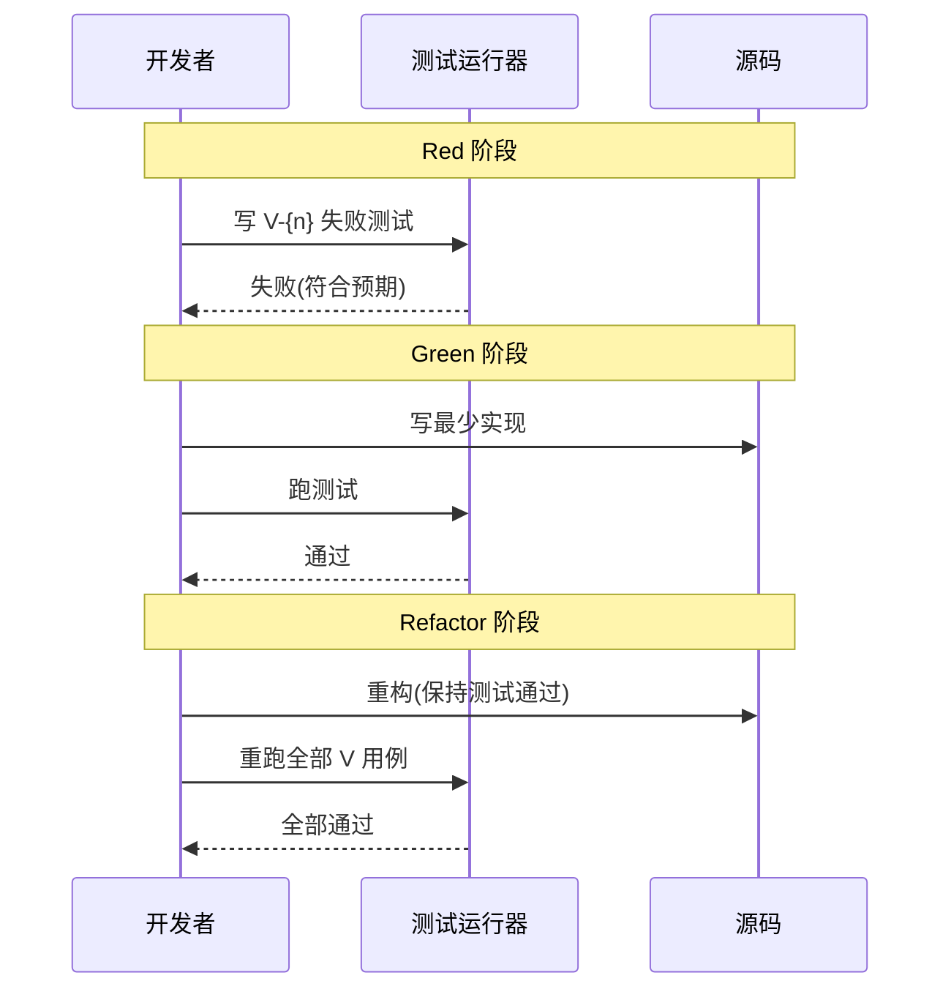

# Plan: {主题}

> **状态**: Draft | Ready | Implemented | Deprecated
> **状态主体**: agent:{id} | human:{handle}
> **状态时间**: {YYYY-MM-DDTHH:MM:SS±HH:MM}
> **状态依据**: criteria:{id}[,{id}…] | external:{ref}
> **来源 Tech Design**: [../../tech_design/{YYYY-MM-DD}-{topic}/](../../tech_design/{YYYY-MM-DD}-{topic}/README.md)
> **来源 PRD**: [../../prd/{YYYY-MM-DD}/{topic}.md](../../prd/{YYYY-MM-DD}/{topic}.md)
> **参考 Test Cases**: `test_cases/{YYYY-MM-DD}/{topic}.md`
> **创建日期**: {YYYY-MM-DD}
> **最后更新**: {YYYY-MM-DD}

> **状态取值**: 只能是 `Draft` / `Ready` / `Implemented` / `Deprecated` 四者之一, 不得自造状态名。
> **主体口径**: `agent:<id>` = 机器写入, `human:<handle>` = 人工写入。**agent 不得填 `human:` 前缀、不得代填人名**(INV-3);`--actor` 只接受 `agent:<id>`,**机器不代填人名**。**已知代价**:机器只能证明「人工署名写在本制品的 `## 复审 (Review)` 段内、形态合法、机器没有代填」,**无法证明**「确系本人所写」(实施契约 §5.2 / §6.3)。
> **状态推进**: agent 按 `schema/criteria.json` 的判据推进 —— 判据全绿即可由机器代写 `Ready`;`Implemented` 需外部事实依据(`external:`, 如外部代码仓 PR merged), 且 PRD / Tech Design / Plan 三件套**必须同时**回写;**人可新增素材,或在本制品的 `## 复审 (Review)` 段写署名,然后跑同一条 `bash scripts/ssdctl.sh advance` 推进 —— 人与 agent 走同一条流水线**;上游转 `Deprecated` 时, 引用本 Plan 的 Test Case 一并 `Deprecated`。
> **依据形式**: `criteria:<id>[,{id}…]` = 判据 id 列表, `external:<ref>` = 外部事实。人工介入的载体是本文 `## 复审 (Review)` 段的 `评审人` / `评审方式`,**不写进 `状态依据`**。**状态块 4 行都要写** —— `Draft` 态写当次生成的 `状态主体` / `状态时间` / `状态依据`;升 `Ready` / `Implemented` 时后三行必填且非空。
> **复审块 (4 行, 机器校验)**: `评审人` / `评审日期` / `评审结论` / `评审方式` 4 行都要写(`Draft` 态值可留空, 升 `Ready` 前 4 行必填非空)。取值: 评审人 = `agent:<id>` | 裸 handle(人工), 评审日期 = `YYYY-MM-DD`, 评审结论 = 通过 | 有条件通过 | 需返工, 评审方式 = 自动判据 | 人工介入 | 外部事实。`评审人` 为 `agent:*` 时 `评审方式` 不得为 `人工介入`。
> **填写规则**: 「参考 Test Cases」是可选行 —— 填了必须是仓内**真实存在**、且以 test_cases/ 开头的路径(用反引号包裹);不适用就**删除整行**。
> **稳定 ID**: 验证用例 `### V-n: <名称>`(标题即声明)+ `**场景**: S-n`(声明它覆盖哪个上游 PRD 场景);业务约束 `- B-n <约束>`;跨文件引用对账表末尾的「覆盖」列填被引用条目覆盖的 ID 集合。

> ⚠️ **设计原则**: Plan 是"实施指南",**不是**"替代实现"。变更描述用文字说明策略和约束,指导参与的 agent 写出代码。完整代码在 TDD 阶段产出。

---

## 变更索引 (Change Index)

> 快速扫读所有 Change,详细策略约束见下方"变更清单"各小节

| # | 文件路径 | 类型 | 遵循决策 | 验证 | 状态 |
|---|---------|------|----------|------|------|
| 1 | {file} | 新增/修改/删除 | KD-{n} | V-{n} | ⬜ 待实现 |
| 2 | ... | ... | ... | ... | ... |

---

## 变更清单 (Changes)

> **单仓 / 0 代码仓**: Change 直接列在本段, 用 h3 标题 `### Change #1: {文件路径}`。
> **多仓 (≥2 个关联代码仓)**: 先按仓分组 —— 组标题用 h4 `#### {标识} 变更`, 组内 Change 用 h4 `#### Change #N: {标识}/{路径}`;路径**必须**带 `{标识}/` 前缀, 标识取 AGENTS.md §1.1「标识」列(不写目录名, 不写口语化仓库名)。
> **V 用例不按仓分组**: 按业务场景聚合, 一个场景可横跨多仓(V 用例段独立于本段)。

### Change #1: {文件路径}

**遵循决策**: KD-{n} — 此变更的设计依据

**变更描述**:
- **新增**: {功能描述}
- **修改**: {改动描述}
- **删除**: {移除描述}

**策略约束**:
- {约束 1} — {为什么}
- {约束 2} — {为什么}
- **不做**: {明确排除的行为}

**验证**: V-{n}

---

### Change #2: {文件路径}

**遵循决策**: KD-{n}

**验证**: V-2 / V-3

---

## TDD 执行流程 (TDD Flow)

> 可视化本 Plan 的 TDD 循环(Red → Green → Refactor),供开发时参考

**TDD 循环规则**:
- 每个 V 用例**先写失败测试**(Red),后写实现(Green)
- 一次只让**一个** V 用例从红变绿,避免大爆炸
- Refactor 时**所有** V 用例必须保持绿
- 完成所有 V 用例 → Plan 状态 `Ready → Implemented`,对应 PRD 状态 `Ready → Implemented`

---

## 跨文件引用对账 (Cross-Reference Reconciliation)

> 验证本 Plan 引用的所有外部标识符**都存在且指向正确**——漏一个会导致实现走偏
>
> **路径深度**: Plan 位于 `plan/{YYYY-MM-DD}-{topic}/{topic}.md`, 到 `tech_design/` 是**两级**, 统一写 `../../tech_design/`。
>
> **代际自适应**: Tech Design 有 v4 / v3 两代, 按目录内文件存在性判定(存在 `ards.md` 或 `apis.md` → v4)。
> 下表「来源」列同时给出两代落点, 按本 Plan 实际引用的 TD 代际勾选对应那一行。

| 引用类型 | 标识 | 来源 | 已对账 | 备注 | 覆盖 |
|----------|------|------|--------|------|------|
| 关键决策 | KD-1 | v4: `../../tech_design/{YYYY-MM-DD}-{topic}/ards.md` / v3: `../../tech_design/{YYYY-MM-DD}-{topic}/decisions.md` | [ ] | Change #1 | AC-1 |
| 时序图 | SYS-1 | v4: `../../tech_design/{YYYY-MM-DD}-{topic}/apis.md` / v3: `../../tech_design/{YYYY-MM-DD}-{topic}/interactions.md` | [ ] | V-1 | S-1 |
| 时序图 | MOD-1 | v4: `../../tech_design/{YYYY-MM-DD}-{topic}/apis.md` / v3: `../../tech_design/{YYYY-MM-DD}-{topic}/interactions.md` | [ ] | V-1 | S-1 |
| PRD 需求 | FR-XXX | `../../prd/{YYYY-MM-DD}/{topic}.md` | [ ] | V-1 | AC-1 |
| 验证用例 | V-1 | 本文件 | [ ] | Change #1 | S-1 |
| 验证用例 | V-2 | 本文件 | [ ] | Change #2 | S-2 |
| 验证用例 | V-3 | 本文件 | [ ] | Change #2 | S-3 |

**对账规则**:
- 每一行都必须勾选 `[x]`;**只要还有未勾选行, 判据即不通过**
- 「覆盖」列填**被该行引用条目覆盖的稳定 ID 集合**(如 `AC-1, AC-2`), 该列不得为空
- 找不到引用 = 门禁清单不通过,**禁止**进入 TDD 阶段

---

## 验证用例 (Verification)

> 用 Given/When/Then 描述,这些用例在 TDD 阶段被自动化执行。

### V-1: {正常路径场景名}

**场景**: S-1

- **Given**: {前置条件}
- **When**: {动作}
- **Then**: {预期结果}

### V-2: {异常场景}

**场景**: S-2

- **Given**: {错误前置}
- **When**: {动作}
- **Then**: {错误处理 / 降级行为}

### V-3: {边界场景}

**场景**: S-3

- **Given**: {边界条件}
- **When**: {动作}
- **Then**: {边界结果}

---

## 业务约束 (Business Constraints)

> 每条约束带稳定 ID `B-n`(行级裁决的最小单元载体);`B-n` 在本文件内唯一。

**前置条件**:
- B-1 调用前必须满足的条件
- B-2 ...

**不变量**:
- B-3 执行过程中必须保持的条件

**后置条件**:
- B-4 成功后系统状态变化
- B-5 ...

**副作用**:
- B-6 触发的外部操作
- B-7 失败时是否回滚

---

## 开发约束 (Development Constraints)

| 约束 | 值 |
|------|-----|
| 并发 | {策略} |
| 事务边界 | {边界} |
| 幂等性 | {保证方式} |
| 重试 | {策略} |
| 超时 | {设置} |

---

## 完成检查 (Completion Gate)

### 实现层
- [ ] **代码实现** — 所有 Change 已完成
- [ ] **类型检查** — 类型检查通过
- [ ] **规范检查** — Lint 通过
- [ ] **无遗留** — 无未解决的 TODO/FIXME

### 验证层
- [ ] **测试通过** — 所有 V 用例通过(Red → Green → Refactor)
- [ ] **约束满足** — 业务约束 + 开发约束全部满足

### 引用层(对应"跨文件引用对账"表)
- [ ] **KD 引用对账** — 所有 KD-{n} 在 `../../tech_design/{YYYY-MM-DD}-{topic}/ards.md` (v4) 或 `../../tech_design/{YYYY-MM-DD}-{topic}/decisions.md` (v3) 中存在
- [ ] **MOD/SYS 引用对账** — 所有时序图在 `../../tech_design/{YYYY-MM-DD}-{topic}/apis.md` (v4) 或 `../../tech_design/{YYYY-MM-DD}-{topic}/interactions.md` (v3) 中存在
- [ ] **V 引用闭环** — 每个 V 用例有对应 Change,每个 Change 至少 1 个 V

### 流程层
- [ ] **PR 已创建** — 如适用

---

## 复审 (Review)

> 本段是**机器必填段**。四行(`评审人` / `评审日期` / `评审结论` / `评审方式`)是**评审签署**载体 —— `Draft` 阶段清空, 升 `Ready` 前由 agent 按 `schema/criteria.json` 的判据填写真值并翻转状态。
> `评审人` 取值: `agent:<id>` = 机器签署, 裸 handle = 人工签署。**agent 不得填 `human:` 前缀、不得代填人名**(INV-3)。
> `评审方式` 取值: `自动判据` / `人工介入` / `外部事实`;`评审人` 为 `agent:*` 时 `评审方式` 不得为 `人工介入`。
> Plan 的 `Implemented` 需外部事实依据(外部代码仓 PR merged), 且 PRD / Tech Design / Plan 三件套必须同时回写。

> **评审人**: agent:{id} | {github-handle}
> **评审日期**: {YYYY-MM-DD}
> **评审结论**: {通过 / 有条件通过 / 需返工}
> **评审方式**: {自动判据 / 人工介入 / 外部事实}

---

## 变更记录 (Change Log)

| 日期 | 变更 |
|------|------|
| {YYYY-MM-DD} | 初始 |
