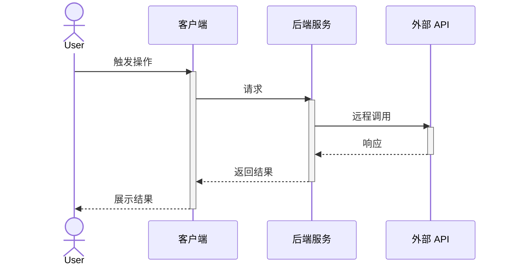
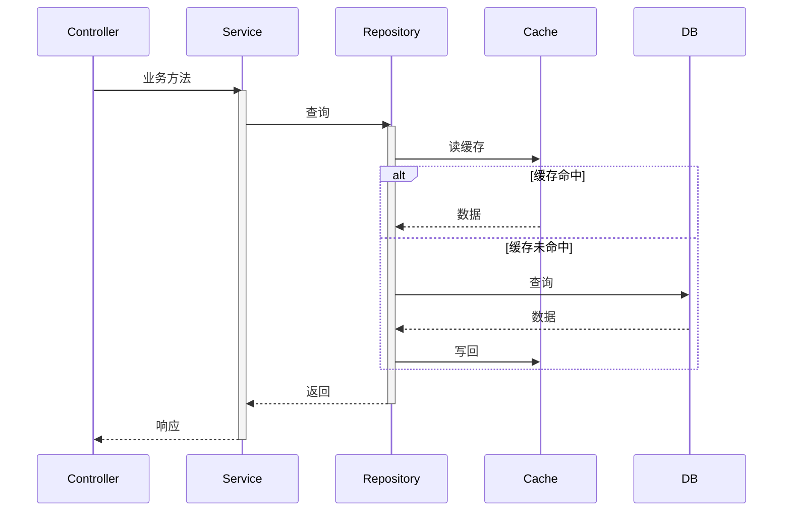

# APIs: {topic} (接口契约 + 时序交互)

> **状态**: Draft | Ready | Implemented | Deprecated
> **来源 PRD**: [../../prd/{YYYY-MM-DD}/{topic}.md](../../prd/{YYYY-MM-DD}/{topic}.md)
> **创建日期**: {YYYY-MM-DD}
> **最后更新**: {YYYY-MM-DD}

> **状态取值**: 只能是 `Draft` / `Ready` / `Implemented` / `Deprecated` 四者之一;本子文件状态**跟随** [./README.md](./README.md) 的状态行, 由人工统一翻转, agent 不得自行改写。
> **v4 必填子文件**: 接口契约 + 时序交互的**唯一落点**.
> 端点 / 请求 / **全响应变体** / 枚举速查 / 组装规则 / 前后置 / 副作用 + 时序图 (SYS-{n} 系统级 / MOD-{n} 模块级).
> **升级条件**: 如果 API 数 > 5 或跨服务, 改用 `contracts/` 子目录, 每个 API 一个文件 (`contracts/{module}.md`), 本文件退化为索引.

---

## 接口总览 (Overview)

| # | 接口名 | 端点 | 用途 | 来源场景 | KD | 时序图 |
|---|--------|------|------|----------|----|----|
| 1 | [接口名] | `METHOD /path` | [一句话] | PRD 场景 {n} | KD-1 | SYS-{n} / MOD-{n} |

---

## 接口契约 (API Contracts)

> **质量铁律**: 必须覆盖**所有响应变体** (成功 / 失败 / 冲突 / 重置 ...), 每个变体带完整 JSON 示例; 有枚举的给枚举速查表; 有组装逻辑的给组装规则矩阵. 禁止只写一个通用请求/响应.

### 接口 1: {端点名}

| 字段 | 内容 |
|------|------|
| **端点路径** | `[METHOD] /path/{id}` |
| **请求方法** | GET / POST / PUT / DELETE |
| **鉴权要求** | [Bearer Token / Cookie / 签名 / 无] |
| **调用方** | [哪个模块 / 角色] |
| **被调方** | [哪个服务 / 模块] |
| **触发时机** | [用户操作 / 定时 / 系统事件] |

**请求参数**:

| 参数 | 类型 | 必填 | 说明 | 校验规则 |
|------|------|------|------|----------|
| `{param}` | `string` | 是 | [说明] | [规则] |

**响应 (成功 200)**:

```json
{
  "code": 0,
  "data": {
    "{field}": "{value}"
  },
  "message": "success"
}
```

**响应 (失败 - 业务错误码)**:

```json
{
  "code": 40001,
  "data": null,
  "message": "[用户可读错误信息]"
}
```

**响应 (失败 - 系统错误码)**:

```json
{
  "code": 50001,
  "data": null,
  "message": "[系统错误信息, 不暴露内部细节]"
}
```

**响应 (其他变体 - 冲突 / 重置 / 空结果 ...)**:

```json
{
  "code": 40901,
  "data": null,
  "message": "[该变体的错误说明]"
}
```

**前后置条件**:

- **前置**: [调用前必须满足的条件]
- **后置**: [调用成功后系统状态的变更]
- **副作用**: [对外部系统的写操作, 如发送通知 / 写日志 / 触发其他流程]

**关联 KD**: KD-1 (见 [./ards.md](./ards.md))
**关联场景**: PRD 场景 {n}

---

### 接口 2: {端点名}

[同上结构]

---

## 枚举速查 (Enum Quick Reference)

| 枚举 | 值 | 含义 |
|------|---|------|
| **StatusEnum** | `pending` / `active` / `completed` / `archived` / `cancelled` | 通用状态机示例 |
| **[其他枚举]** | ... | ... |

---

## 组装规则 (Composition Rules)

> 跨接口调用时的组合方式, 如先调用 A 拿 token 再调用 B 传 token.

| 场景 | 调用顺序 | 失败处理 |
|------|----------|----------|
| [场景 1] | A → B → C | A 失败直接返回, B/C 不调用 |
| [场景 2] | A → (B 并行 C) → D | B 或 C 任一失败, 整体失败 |

---

## 时序交互 (Sequence Diagrams)

> **格式**: Mermaid `sequenceDiagram`. 满足以下**任一**条件时本节必填, 否则可在门禁清单声明 N/A:
> - [ ] 场景映射表行数 ≥ 5
> - [ ] 涉及外部接口调用
> - [ ] 涉及 ≥ 2 个内部模块协作
> - [ ] 包含异步流程、状态机或重试逻辑

### 系统级交互 (System-Level)

> 描述与外部系统 / 服务 / 用户的交互流程

#### SYS-1: {流程名}

**Reference**: PRD 场景 {n}
**Trigger**: {触发条件}
**引用决策**: KD-1



**Notes**:
- 超时设置: {外部 API 调用 N 秒}
- 重试策略: {最多 N 次, 退避策略}
- 降级行为: {失败时降级为 ...}
- 幂等性: {请求是否幂等, 如何保证}

### 模块级交互 (Module-Level)

> 描述内部模块 / 组件的交互流程

#### MOD-1: {流程名}

**Reference**: PRD 场景 {n}
**Trigger**: {触发条件}
**引用决策**: KD-1



**Notes**:
- 事务边界: {哪个组件开启 / 提交事务}
- 幂等性: {写操作如何保证幂等}
- 缓存策略: {缓存粒度, 失效时间}
- 错误处理: {异常路径}

---

## Mermaid 语法参考

| 场景 | 写法 |
|------|------|
| 同步调用 | `A->>B: msg` |
| 返回 | `B-->>A: result` |
| 异步消息 | `A-)B: msg` (无激活线) |
| 条件分支 | `alt 条件A ... else 条件B ... end` |
| 可选分支 | `opt 条件 ... end` |
| 循环 | `loop 描述 ... end` |
| 关键区 | `critical 操作 ... option 超时 ... end` |
| 注释 | `Note over A,B: 说明文字` |
| 激活 | `activate A` / `deactivate A` |
| 参与者类型 | `actor` (用户) / `participant` (组件) / `database` (DB) |

---

## 门禁清单 (Completion Gate)

- [ ] 接口总览表与契约段一一对应
- [ ] 每个接口有 端点 / 方法 / 鉴权 / 调用方 / 触发时机 5 个基础字段
- [ ] 每个接口有 请求参数表 (类型 / 必填 / 校验规则)
- [ ] 每个接口有 全响应变体 (成功 + 业务错误 + 系统错误 + 其他变体 各 1 例)
- [ ] 前后置条件 + 副作用显式声明
- [ ] 字段类型明确 (**不用 `any`**), 错误码有具体值 (**不用 `4xx` 泛指**)
- [ ] 枚举速查表覆盖所有字符串 / 整数枚举字段
- [ ] 组装规则覆盖所有多接口组合场景
- [ ] 时序图 (SYS-{n}) 覆盖所有跨模块场景
- [ ] 模块级时序图 (MOD-{n}) 覆盖关键内部路径
- [ ] 时序图满足必填条件时: 每图有 Reference + Trigger + Notes (超时 / 重试 / 降级 / 事务 / 幂等 至少 2 项), 编号唯一 (SYS-{n} / MOD-{n}); 不满足条件时此处声明 N/A 及理由
- [ ] Mermaid 语法可在 GitHub 渲染

---

## 变更记录 (Change Log)

| 日期 | 变更 |
|------|------|
| {YYYY-MM-DD} | 初始: apis.md (v4 结构, 合并 v3 的 api-contracts + interactions) |
