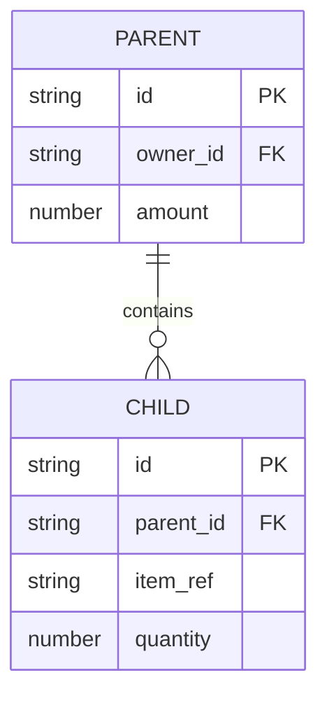

# Data Model: {topic} (ER 图 + 数据结构)

> **状态**: Draft | Ready | Implemented
> **来源**: [./README.md](./README.md)
> **创建日期**: {YYYY-MM-DD}
> **最后更新**: {YYYY-MM-DD}

> **v4 必填子文件**: 数据模型的**唯一落点**。ER 图 + 数据结构明细 + 约束 + 与 PRD 场景的关系。
> **无变更时**: 必须保留显式声明句 `无数据模型变更: [一句话原因]`, 校验脚本据此放行。

---

## ER 图 (Entity-Relationship)

> Mermaid `erDiagram`。覆盖本需求涉及的全部实体及关系 (新增 + 被改动的既有实体)。
> **若本需求不涉及数据模型变更**, 删除下方 mermaid 块, 保留声明句:
> `> 无数据模型变更: [一句话原因, 如 纯展示逻辑 / 仅复用既有表 / 无关联代码仓]`

**关系说明**:
- [实体 A] 1—N [实体 B]: [关系语义, 外键字段]
- [实体 B] N—1 [实体 C]: [关系语义]

---

## 数据结构明细 (Data Structures)

### {模型名 1}

> **存储位置**: [DB 表名 / 本地缓存 / 接口 DTO], 标注归属仓库标识 (AGENTS.md §1.1 的 A / B / C)

| 字段 | 类型 | 必填 | 默认值 | 说明 |
|------|------|------|--------|------|
| id | string | ✓ | — | 唯一标识 |
| {field} | {type} | {✓/—} | {默认值} | {说明} |

**约束**:
- {field} 不可为空
- {field} 范围: {range}
- 唯一性 / 联合约束: {说明}

**索引 / 主外键**:
- PK: {field}
- FK: {field} → {表.field}
- INDEX: {field} ({查询场景})

**关联场景**: PRD 场景 {n}
**引用决策**: KD-1 (见 [./ards.md](./ards.md))
**时序图**: SYS-{n} / MOD-{n} (见 [./apis.md](./apis.md))

---

### {模型名 2}

[同上结构]

---

## 与 PRD 场景的关系

> 每个实体必须能回溯到 PRD 场景, 否则该实体是「无来源的投机建模」。

| 实体 | 来源 PRD 场景 | 步骤 | 读 / 写 | 关联决策 | 关联时序图 |
|------|---------------|------|---------|----------|------------|
| {模型名 1} | 场景 {n} | 1 | 写 | KD-1 | MOD-1 |
| {模型名 2} | 场景 {n} | 2 | 读 | KD-1 | MOD-1 |

**核对**:
- [ ] 每个实体至少映射到 1 个 PRD 场景
- [ ] PRD 中涉及数据持久化的场景, 均有对应实体
- [ ] 「无数据模型变更」时, 本表写单行 `> 不适用: [原因]` 并说明为何不需要新实体

---

## 门禁清单 (Completion Gate)

- [ ] ER 图存在且覆盖全部涉及实体; **或** 已用「无数据模型变更」声明句显式说明
- [ ] ER 图与数据结构明细一一对应 (无孤儿实体 / 孤儿表)
- [ ] 每个模型有字段表 + 约束段 + 索引 / 主外键
- [ ] 数据类型用 TS / SQL / JSON Schema 等具体类型, **不用 `string` / `number` 泛指**
- [ ] 默认值显式化 (每个有默认值的字段标注默认值及来源)
- [ ] 「与 PRD 场景的关系」表已填写, 每个实体可回溯到 PRD 场景
- [ ] 关联场景、决策、时序图编号已填写

---

## 变更记录 (Change Log)

| 日期 | 变更 |
|------|------|
| {YYYY-MM-DD} | 初始: data-model.md (v4 结构, 新增 ER 图段 + 场景关系段) |
